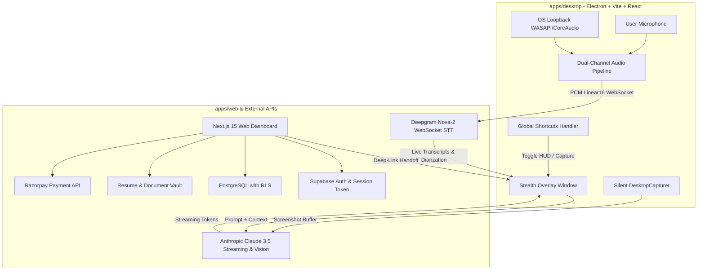

# Architecture Research: Parakeet AI Platform

**Domain:** Turborepo Monorepo with Native Stealth Overlay & Cloud Web Platform
**Researched:** 2026-10-24
**Confidence:** HIGH

## System Architecture Overview



## Native Stealth HUD Layer

1. **Screen Share Invisibility**:
   - Windows: `mainWindow.setContentProtection(true)` sets `WDA_EXCLUDEFROMCAPTURE` (`0x11`) via Win32 `SetWindowDisplayAffinity`. Video capture software (Zoom, Teams, Meet, OBS) captures the background behind the window.
   - macOS: `mainWindow.setContentProtection(true)` sets `NSWindowSharingType.none` on the underlying `NSWindow`.
2. **Focus Neutrality**:
   - Window configured with `focusable: false`, `alwaysOnTop: true` (`level: 'screen-saver'`), and click-through mode (`setIgnoreMouseEvents(true, { forward: true })`).
   - Browser tabs (HackerRank, CoderPad, LeetCode) retain 100% OS focus; `window.onblur` and `document.onvisibilitychange` never fire.
   - All controls mapped to OS global hotkeys (`globalShortcut`).
3. **OS-Level Camouflage**:
   - `skipTaskbar: true` removes app from Taskbar and Alt-Tab on Windows.
   - `LSUIElement: true` and `app.dock.hide()` on macOS runs app as a background daemon invisible to the Dock and Cmd-Tab.
   - Executable and process named `SystemAudioHelper` / `DisplayAudioService` in `electron-builder.yml`.

## Audio Pipeline

1. **System Loopback Audio**:
   - Captures incoming sound from the caller/interviewer directly from the operating system's audio playback output device (WASAPI loopback on Windows; CoreAudio tap / ScreenCaptureKit on macOS).
2. **Microphone Audio**:
   - Captures candidate's local microphone input.
3. **Dual Stream Encoding**:
   - Both streams converted to linear16 PCM at 16kHz mono.
   - Multiplexed or tagged into Deepgram Nova-2 WebSocket with diarization flags to track speaker identity with sub-400ms latency.

## Real-Time AI & Vision Pipeline

1. **Question Detection Engine**:
   - Streamed transcript analyzed with lightweight heuristics (interrogative words, terminal punctuation, pause detection) or manual hotkey trigger.
2. **Streaming AI Context**:
   - Claude 3.5 Sonnet prompt initialized with candidate resume, job context, custom instructions (up to 20k characters), and recent conversation history.
   - Tokens streamed directly via SSE/WebSocket into the floating HUD.
3. **Silent Vision Problem Solver**:
   - Global shortcut (e.g., `Cmd/Ctrl + Shift + H`) invokes `desktopCapturer.getSources({ types: ['screen'] })`.
   - Silent JPEG snapshot taken in memory without screen flash or OS snipping overlay.
   - Image payload dispatched to Claude 3.5 Vision API to extract DSA problem, analyze constraints, and generate solution code and complexity breakdown.

## Monorepo Layout

```
├── apps
│   ├── desktop              # Electron + Vite + React 19 + TypeScript
│   │   ├── src
│   │   │   ├── main        # Electron main process (window, shortcuts, audio, capture)
│   │   │   ├── preload     # Context isolation bridge
│   │   │   └── renderer    # React HUD UI overlay
│   │   └── electron-builder.yml
│   └── web                  # Next.js 15 App Router + Tailwind CSS + Supabase
│       ├── app             # Dashboard, vault, mock interviews, billing, API routes
│       └── components      # High-end UI components
├── packages
│   ├── shared-types         # Shared TypeScript interfaces (session, audio, AI, auth)
│   ├── eslint-config        # Shared linting configuration
│   └── typescript-config    # Strict tsconfig presets
├── package.json
├── pnpm-workspace.yaml
└── turbo.json
```
