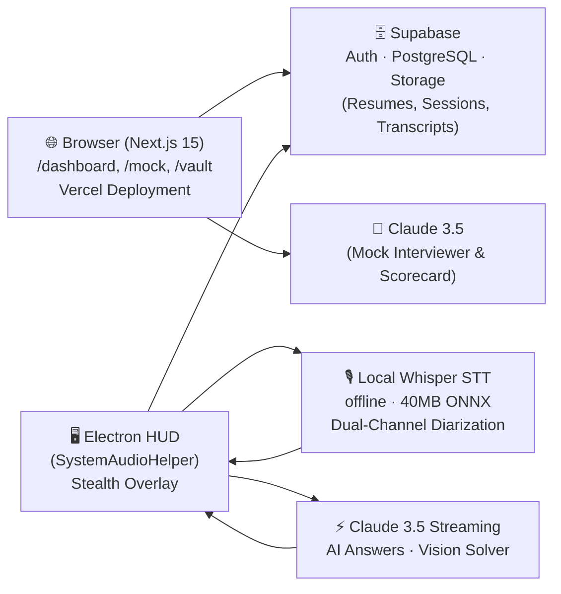

# GhostPilot — Real-Time Stealth AI Interview Copilot

     

**GhostPilot** is a production-grade, real-time AI Interview & Call Copilot. It delivers sub-second answers, live speech transcription, and silent coding problem solutions during technical interviews — while remaining completely invisible to screen shares (Zoom, Google Meet, Teams).

- **100% Free & Unlimited** — No paid API for audio (local offline Whisper STT) or billing paywalls.
- **Stealth-first** — The Electron HUD is invisible to screen capture using `setContentProtection(true)` (Win32 `WDA_EXCLUDEFROMCAPTURE` / macOS `NSWindowSharingNone`).
- **Zero-blur anti-detection** — The HUD never steals OS focus (`focusable: false`, `showInactive()`).

---

## Architecture Overview



---

## Prerequisites

| Tool | Version | Install |
|------|---------|---------|
| Node.js | 20+ | [nodejs.org](https://nodejs.org) |
| pnpm | 9+ | `npm i -g pnpm` |
| Git | Any | [git-scm.com](https://git-scm.com) |

**Optional (for full AI features):**
- [Supabase](https://supabase.com) project (free tier works)
- [Anthropic](https://console.anthropic.com) Claude API key

---

## Quick Start

```bash
# 1. Clone the repository
git clone https://github.com/your-org/ghostpilot.git
cd ghostpilot

# 2. Install all dependencies (monorepo)
pnpm install

# 3. Configure environment variables
cp apps/web/.env.example apps/web/.env.local
cp apps/desktop/.env.example apps/desktop/.env
# Edit both files with your Supabase and Anthropic keys

# 4. Start both web and desktop in development mode
pnpm dev
```

The web dashboard opens at **http://localhost:3000**.  
The Electron stealth HUD opens automatically in the top-right corner of your screen.

---

## Development Commands

### Monorepo (Turborepo)

```bash
pnpm dev               # Start all apps concurrently
pnpm build             # Build all apps for production
pnpm turbo typecheck   # Type-check all packages
pnpm turbo lint        # Lint all packages
```

### Web Platform (`apps/web`)

```bash
pnpm --filter @ghostpilot/web dev        # Next.js dev server (port 3000)
pnpm --filter @ghostpilot/web build      # Production build
pnpm --filter @ghostpilot/web test:unit  # Vitest unit tests
pnpm --filter @ghostpilot/web test:e2e   # Playwright E2E tests
```

### Desktop HUD (`apps/desktop`)

```bash
pnpm --filter @ghostpilot/desktop dev    # Electron + Vite HMR dev mode
pnpm --filter @ghostpilot/desktop build  # Production Vite build
pnpm --filter @ghostpilot/desktop test   # All CJS test suites
```

---

## First-Run: Local Whisper Model Download

On the **first time** you start audio capture in the Electron HUD, the app will automatically download the local Whisper speech-to-text model:

- **Model**: `onnx-community/whisper-base.en` (quantized 8-bit ONNX)
- **Size**: ~40 MB
- **Internet required**: Only on first run
- **After first run**: Fully offline forever — cached in Electron app data

You will see a loading indicator in the HUD ("Loading Whisper model...") during the one-time download. After ~10–30 seconds depending on your connection, the badge changes to "Whisper STT (100% Offline) ✓".

---

## Keyboard Shortcuts (Desktop HUD)

| Shortcut | Action |
|----------|--------|
| `Ctrl/Cmd + Shift + V` | Toggle HUD visibility |
| `Ctrl/Cmd + Shift + M` | Toggle click-through mode |
| `Ctrl/Cmd + Shift + ↑` | Increase HUD opacity |
| `Ctrl/Cmd + Shift + ↓` | Decrease HUD opacity |
| `Ctrl/Cmd + Shift + H` | Trigger AI answer (manual) |

---

## Environment Variables

### `apps/web/.env.local`

| Variable | Required | Description |
|----------|----------|-------------|
| `NEXT_PUBLIC_SUPABASE_URL` | ✅ Yes | Your Supabase project URL |
| `NEXT_PUBLIC_SUPABASE_ANON_KEY` | ✅ Yes | Supabase anonymous API key |
| `ANTHROPIC_API_KEY` | ⚡ Optional | Claude API key. Without it, mock interviewer uses built-in simulated responses |

### `apps/desktop/.env`

| Variable | Required | Description |
|----------|----------|-------------|
| `VITE_SUPABASE_URL` | ✅ Yes | Supabase project URL |
| `VITE_SUPABASE_ANON_KEY` | ✅ Yes | Supabase anonymous API key |
| `VITE_ANTHROPIC_API_KEY` | ✅ Yes | Claude API key for real-time HUD answers |

---

## Running Tests

```bash
# Desktop test suite (Electron + Node CJS)
pnpm --filter @ghostpilot/desktop test
# ✓ stealth-verification.cjs     — 7 stealth API assertions
# ✓ pcm-multiplexer.test.cjs     — Dual-channel PCM interleaving
# ✓ local-whisper-stt.test.cjs   — VAD + diarization + zero-API-key
# ✓ question-detector.test.cjs   — Question detection & prompt assembly
# ✓ vision-capture.test.cjs      — Screenshot sanitization & Vision payload

# Web unit tests (Vitest)
pnpm --filter @ghostpilot/web test:unit
# ✓ extractor.test.ts             — Text normalization & extraction
# ✓ respond.test.ts               — Simulated response selection logic
# ✓ upload-validation.test.ts     — File size & MIME type validation

# Web E2E tests (Playwright)
pnpm --filter @ghostpilot/web test:e2e
# ✓ Homepage branding & CTA buttons
# ✓ Login page authentication controls
# ✓ Unauthenticated /dashboard redirect
# ✓ /api/health returns { status: "ok" }
```

---

## Building Desktop Installers

```bash
# Windows NSIS installer (.exe)
pnpm --filter @ghostpilot/desktop dist:win
# Output: apps/desktop/release/SystemAudioHelper Setup 1.0.0.exe

# macOS DMG (requires macOS host for signing)
pnpm --filter @ghostpilot/desktop dist:mac
# Output: apps/desktop/release/SystemAudioHelper-1.0.0-x64.dmg

# Both platforms (cross-compile where possible)
pnpm --filter @ghostpilot/desktop dist
```

The packaged binary will be named **`SystemAudioHelper`** — a neutral process name that doesn't reveal its purpose in Windows Task Manager or macOS Activity Monitor.

**Electron security fuses** are automatically applied at package time:
- `RunAsNode: false` — prevents `ELECTRON_RUN_AS_NODE` abuse
- `EnableNodeCliInspectArguments: false` — disables `--inspect` debugging of packed binary
- `OnlyLoadAppFromAsar: true` — enforces ASAR-only app loading (tamper protection)

---

## Deploy to Vercel

[](https://vercel.com/new/clone?repository-url=https://github.com/your-org/ghostpilot&root-directory=apps/web&env=NEXT_PUBLIC_SUPABASE_URL,NEXT_PUBLIC_SUPABASE_ANON_KEY,ANTHROPIC_API_KEY&envDescription=Supabase%20and%20Anthropic%20API%20keys&project-name=ghostpilot)

Manual deployment:
```bash
cd apps/web
vercel --prod
```

Set these environment variables in your Vercel project dashboard:
- `NEXT_PUBLIC_SUPABASE_URL`
- `NEXT_PUBLIC_SUPABASE_ANON_KEY`
- `ANTHROPIC_API_KEY` (optional)

---

## Project Structure

```
ghostpilot/
├── apps/
│   ├── web/                    # Next.js 15 web dashboard
│   │   ├── src/app/
│   │   │   ├── dashboard/      # /vault, /mock, /sessions, /questions
│   │   │   └── api/            # /vault, /mock, /health
│   │   └── tests/              # Playwright E2E tests
│   └── desktop/                # Electron 33 stealth HUD
│       ├── src/
│       │   ├── main/           # Electron main process
│       │   ├── preload/        # contextBridge IPC bridge
│       │   └── renderer/       # React 19 HUD UI
│       │       └── services/   # AudioCapture, LocalWhisper, AIAnswerEngine
│       └── tests/              # CJS test suites
└── packages/
    └── shared/                 # Shared TypeScript types
```

---

## License

MIT © 2024 GhostPilot Contributors
