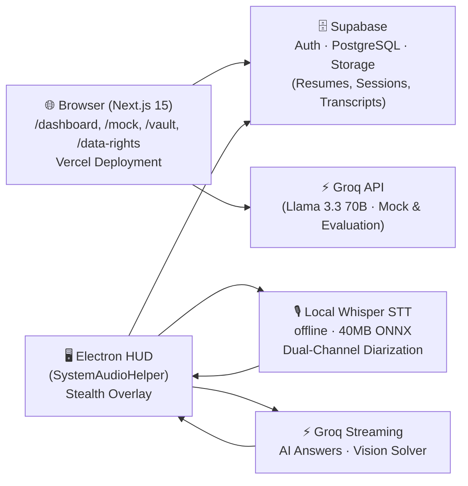

# GhostPilot — Real-Time Stealth AI Interview Copilot

      

**GhostPilot** is a production-grade, 100% free real-time AI Interview & Call Copilot. It delivers sub-second answers, live speech transcription, and silent coding problem solutions during technical interviews — while remaining completely invisible to screen shares (Zoom, Google Meet, Teams).

- **100% Free & Unlimited** — Powered by Groq Cloud (`llama-3.3-70b-versatile`, `llama-3.2-11b-vision-preview`), local offline Whisper STT, and zero billing paywalls.
- **Stealth-first** — The Electron HUD is invisible to screen capture using `setContentProtection(true)` (Win32 `WDA_EXCLUDEFROMCAPTURE` / macOS `NSWindowSharingNone`).
- **Zero-blur anti-detection** — The HUD never steals OS focus (`focusable: false`, `showInactive()`).
- **Resume Vault with Identity Extraction** — Fast PDF/DOCX parsing via `unpdf` and `mammoth` with automatic regex extraction of candidate contact info and experience years.
- **Practice Assessment Suite** — Interactive Mock Interview room with pre-flight Waiting Room device check, real-time speech analytics (WPM, filler detection), proctoring fair-play simulation, and DPDP/GDPR Data Rights portal.

---

## Architecture Overview



---

## Prerequisites

| Tool | Version | Install |
|------|---------|---------|
| Node.js | 20+ | [nodejs.org](https://nodejs.org) |
| pnpm | 9+ | `npm i -g pnpm` |
| Git | Any | [git-scm.com](https://git-scm.com) |

**API Keys Required:**
- [Supabase](https://supabase.com) project (free tier works)
- [Groq](https://console.groq.com) API key (free tier works)

---

## Quick Start

```bash
# 1. Clone the repository
git clone https://github.com/Saksham842/helper.git
cd helper

# 2. Install all dependencies (monorepo)
pnpm install

# 3. Configure environment variables
cp apps/web/.env.example apps/web/.env.local
cp apps/desktop/.env.example apps/desktop/.env
# Edit both files with your Supabase and Groq keys (starts with gsk_)

# 4. Start both web and desktop in development mode
pnpm dev
```

- Web Dashboard: [http://localhost:3000](http://localhost:3000)
- Desktop HUD: Starts in background with invisible overlay window

---

## Global Keyboard Shortcuts (Desktop HUD)

| Shortcut | Action | Description |
|----------|--------|-------------|
| `Ctrl+Alt+H` / `Cmd+Shift+H` | **Toggle HUD** | Show / hide the floating overlay without losing OS focus |
| `Ctrl+Alt+X` / `Cmd+Shift+X` | **Click-Through** | Toggle mouse pass-through mode so you can click IDE underneath |
| `Ctrl+Alt+V` / `Cmd+Shift+V` | **Vision Solve** | Take silent screen capture and stream Groq Vision DSA solution |
| `Ctrl+Alt+C` / `Cmd+Shift+C` | **Clear Chat** | Clear active answer stream and reset prompt context |

---

## Environment Variables

### `apps/web/.env.local`

| Variable | Required | Description |
|----------|----------|-------------|
| `NEXT_PUBLIC_SUPABASE_URL` | ✅ Yes | Your Supabase project URL |
| `NEXT_PUBLIC_SUPABASE_ANON_KEY` | ✅ Yes | Supabase anonymous API key |
| `GROQ_API_KEY` | ✅ Yes | Groq API key (`gsk_...`) for streaming AI answers & evaluations |

### `apps/desktop/.env`

| Variable | Required | Description |
|----------|----------|-------------|
| `VITE_SUPABASE_URL` | ✅ Yes | Supabase project URL |
| `VITE_SUPABASE_ANON_KEY` | ✅ Yes | Supabase anonymous API key |
| `VITE_GROQ_API_KEY` | ✅ Yes | Groq API key (`gsk_...`) for real-time HUD answers & vision solver |

---

## Running Tests

```bash
# Desktop test suite (Electron + Node CJS)
pnpm --filter @ghostpilot/desktop test
# ✓ stealth-verification.cjs     — 7 stealth API assertions
# ✓ pcm-multiplexer.test.cjs     — Dual-channel PCM interleaving
# ✓ local-whisper-stt.test.cjs   — VAD + diarization + zero-API-key
# ✓ question-detector.test.cjs   — Question detection & prompt assembly
# ✓ vision-capture.test.cjs      — Screenshot sanitization & Vision payload

# Web unit tests (Vitest)
pnpm --filter @ghostpilot/web test:unit
# ✓ extractor.test.ts             — Text normalization & unpdf extraction
# ✓ respond.test.ts               — Evaluation & response logic
# ✓ upload-validation.test.ts     — File size & MIME type validation

# Web E2E tests (Playwright)
pnpm --filter @ghostpilot/web test:e2e
# ✓ Homepage branding & CTA buttons
# ✓ Login page authentication controls
# ✓ Unauthenticated /dashboard redirect
# ✓ /api/health returns { status: "ok" }
```

---

## Building Desktop Installers

```bash
# Windows NSIS installer (.exe)
pnpm --filter @ghostpilot/desktop dist:win
# Output: apps/desktop/release/SystemAudioHelper Setup 1.0.0.exe

# macOS DMG (requires macOS host for signing)
pnpm --filter @ghostpilot/desktop dist:mac
# Output: apps/desktop/release/SystemAudioHelper-1.0.0-x64.dmg

# Both platforms (cross-compile where possible)
pnpm --filter @ghostpilot/desktop dist
```

The packaged binary will be named **`SystemAudioHelper`** — a neutral process name that doesn't reveal its purpose in Windows Task Manager or macOS Activity Monitor.

**Electron security fuses** are automatically applied at package time:
- `RunAsNode: false` — prevents `ELECTRON_RUN_AS_NODE` abuse
- `EnableNodeCliInspectArguments: false` — disables `--inspect` debugging of packed binary
- `OnlyLoadAppFromAsar: true` — enforces ASAR-only app loading (tamper protection)

---

## Deploy to Vercel

Manual deployment:
```bash
cd apps/web
vercel --prod
```

Set these environment variables in your Vercel project dashboard:
- `NEXT_PUBLIC_SUPABASE_URL`
- `NEXT_PUBLIC_SUPABASE_ANON_KEY`
- `GROQ_API_KEY`

---

## Project Structure

```
ghostpilot/
├── apps/
│   ├── web/                    # Next.js 15 web dashboard
│   │   ├── src/app/
│   │   │   ├── dashboard/      # /vault, /mock, /sessions, /questions, /data-rights
│   │   │   └── api/            # /vault, /mock, /health, /user/export-data, /user/account
│   │   ├── src/hooks/          # useSpeechMetrics, useProctoring
│   │   ├── src/lib/            # extractor (unpdf/mammoth), resumeIdentity, groq
│   │   └── tests/              # Playwright E2E tests
│   └── desktop/                # Electron 33 stealth HUD
│       ├── src/
│       │   ├── main/           # Electron main process (SystemAudioHelper)
│       │   ├── preload/        # contextBridge IPC bridge
│       │   └── renderer/       # React 19 HUD UI
│       │       └── services/   # AudioCapture, LocalWhisper, AIAnswerEngine
│       └── tests/              # CJS test suites
└── packages/
    └── shared/                 # Shared TypeScript types, questionBank, evaluation heuristics
```

---

## License

MIT © 2024 GhostPilot Contributors
